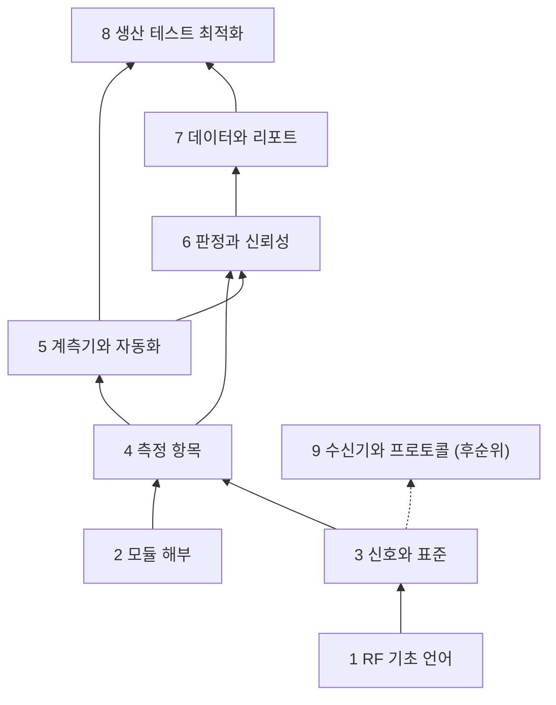

# Project Map

Last updated: 2026-10-25

## North Star

Know RF well enough to build better test programs, test infrastructure, data pipelines, and reports for multi-mode PAMiD / FEM / PA / LNA modules.

## Learner Context

- Role: builds RF test programs and test infrastructure at a module company that makes PAMiD, FEM, PA, and LNA parts
- Daily work: writing measurement programs, processing measurement data, automating reports; does not run measurements by hand
- Why study: test programs get better when the author understands what each measurement means, how instruments are set up, and how results should be judged
- Audience: this project is for one learner only

## Product Vision

RF Study Lab is a personal web study environment. The home page shows the whole roadmap as a map of nine tracks so the overall shape stays visible while items are filled one at a time. Each filled item becomes one of:

- a concise explanation page
- a lab module with a deterministic educational model, prediction, diagnosis, and teach-back (M1 is the first)

## Track Map

The tracks and items are defined in [`src/content/roadmap.ts`](../src/content/roadmap.ts) and summarised in [ROADMAP.md](ROADMAP.md).

## App Map

| Area | Route | State |
| --- | --- | --- |
| Roadmap home | `#/` | Validated |
| M1 GSM Burst / PvT Lab | `#/modules/gsm-pvt/{learn,lab,challenge,review}` | Validated |
| Progress tracking | browser localStorage, schema v3 | Validated for M1 |

Unknown routes redirect to the roadmap home.

## Code Map

| Path | Role |
| --- | --- |
| `src/content/roadmap.ts` | Track and item list; single source for the home page |
| `src/pages/HomePage.tsx` | Roadmap home |
| `src/domain/<topic>/` | Pure RF models and their tests, independent of UI |
| `src/pages/`, `src/components/` | Module screens and shared components |
| `src/state/progress.tsx` | Learning evidence storage and validation |

## Growth Rule

Every new item should answer before it is built:

1. Which test-program decision does it improve?
2. What visual or interactive experience makes the concept easier to understand?
3. How will I know I understood it?
